# Questionnaire-Based Diabetes Risk Screening: Traditional Machine Learning and Deep Learning on BRFSS Health Indicators

**David Shumbusho**  
African Leadership University · Introduction to Machine Learning Summative Project

**GitHub repository:** [Shumbusho43/SummativeML](https://github.com/Shumbusho43/SummativeML)  
**Google Drive (dataset and saved models):** [Project Drive folder](https://drive.google.com/drive/folders/1cvrziKSbJSD7fCHvzdFkXYAlizxkadWu?usp=sharing)  
**Video presentation:** [Watch on YouTube](https://youtu.be/gv-O7atbpes)

## Abstract

Questionnaire-based screening could help identify adults who may benefit from confirmatory diabetes testing where laboratory access is limited. This study compares traditional machine-learning methods with neural networks on the CDC’s 2015 Behavioral Risk Factor Surveillance System (BRFSS) diabetes indicators dataset. The 253,680-row source table was deduplicated before stratified partitioning, leaving 229,474 records and a test set of 34,422 respondents. Six scikit-learn baselines and TensorFlow/Keras models were assessed using ROC-AUC, average precision, threshold-specific measures, bootstrap intervals, calibration, subgroup evaluation, and error analysis. On the held-out test set, tuned histogram gradient boosting reached ROC-AUC 0.817 (95% CI 0.811–0.823), while the best neural network, a Functional wide-and-deep model, reached 0.817 (0.812–0.823). Ranking performance was practically indistinguishable; a paired bootstrap comparing gradient boosting with the wide-and-deep network estimated an AUC difference of −0.0005 (95% CI −0.0016 to 0.0005). A validation-selected threshold targeting at least 80% sensitivity yielded approximately 80% test recall and 68% specificity. Threshold selection and the information available in the questionnaire mattered more than model family. The models may support referral prioritisation, but not diagnosis or estimation of future disease risk. Their U.S. source population, self-reported labels, imperfect calibration, and uneven subgroup sensitivity make local validation and recalibration prerequisites for any practical use.

**Index Terms—** diabetes screening, class imbalance, BRFSS, gradient boosting, deep learning, tabular data, calibration, subgroup performance.

## I. Introduction

Diabetes is a major cause of preventable illness, and a substantial share of its burden arises while people live with the condition without knowing it. The International Diabetes Federation estimated that approximately 24 million adults in Africa had diabetes in 2021 and that a large proportion remained undiagnosed [1]. Persistent hyperglycaemia can damage the kidneys, eyes, nerves, and cardiovascular system; timely identification can enable clinical assessment and treatment before complications progress [2]. However, routine diagnostic tests require consumables, trained personnel, and functioning laboratory or point-of-care systems. Access to those resources is uneven, especially outside urban clinics.

A short questionnaire offers a complementary intervention. Community health workers can ask about age, body mass index (BMI), hypertension, cholesterol, mobility, and general health without laboratory equipment. A model could combine answers into a referral-priority score for confirmatory testing, not assert a diagnosis. This project asks how well such indicators rank respondents with prediabetes or diabetes, and whether a neural network materially outperforms traditional machine learning on tabular data.

The analysis uses the CDC Diabetes Health Indicators dataset, derived from the 2015 U.S. Behavioral Risk Factor Surveillance System (BRFSS) and distributed through the UCI Machine Learning Repository [3]. Its 21 predictors describe health conditions, behaviours, demographic categories, and access to care. The binary outcome combines prediabetes and diabetes. Although the project is motivated partly by the potential need for inexpensive screening in African settings, the source data represent U.S. adults surveyed in 2015. The study therefore evaluates methods on a large public dataset; it does not establish performance in Rwanda or elsewhere in Africa.

Four design choices shape the investigation. Exact duplicates are removed before splitting to limit train-test leakage [17]; all models use shared stratified partitions and consistent preprocessing. Class weighting and validation-selected thresholds are assessed explicitly because the 15% positive class makes default-threshold accuracy misleading. Evaluation also includes bootstrap uncertainty, calibration, subgroup recall, and false-negative profiling.

The report is organised as follows. Section II reviews clinical risk scores, machine learning for diabetes, and the comparative evidence on deep learning for structured data. Section III describes the dataset, preprocessing, model development, and evaluation protocol. Section IV presents the results, and Section V interprets them alongside the study’s limitations. Section VI concludes with recommendations for future validation.

## II. Literature Review

### A. Questionnaire-based clinical risk assessment

Questionnaire risk assessment predates contemporary machine learning. The Finnish Diabetes Risk Score (FINDRISC) combines age, BMI, waist circumference, physical activity, diet, medication for hypertension, and prior high glucose into an interpretable point total [4]. Bang *et al.* developed and validated a patient self-assessment score for diabetes risk in the United States [5]. These instruments demonstrate the practical appeal of short, low-cost questionnaires: they can be administered without specialist equipment and can translate a set of risk factors into a referral recommendation.

Conventional scores use predefined additive contributions. Their transparency is valuable, but fixed weights may miss nonlinear relationships and interactions, such as associations between age and BMI. Statistical learning can estimate these patterns, although complexity does not guarantee better screening performance or fairness and can make validation and explanation harder. Most established scores were also developed in European or North American cohorts, and their transfer to African populations, where body composition, diet and age structure differ, cannot be assumed [26].

### B. Machine learning and diabetes prediction

Many studies apply classifiers to diabetes datasets. The 768-record Pima Indians dataset includes measurements such as plasma glucose and insulin [6], strong predictors unavailable at the initial stage of questionnaire screening. Dinh *et al.* evaluated diabetes and cardiovascular prediction using U.S. survey data [7], while Zou *et al.* compared classifiers on physical-examination records [8]. Taken together, these studies show a consistent pattern: discrimination is highest when laboratory measurements are available and lower when models rely on self-report alone, which sets realistic expectations for a questionnaire-only tool.

Xie *et al.* are especially relevant because they developed type 2 diabetes risk models using BRFSS survey information [9]. Their comparison included logistic regression, support vector machines, decision trees, random forests, naïve Bayes, and a neural network, with discrimination around an AUC of 0.80. Their results support the proposition that self-reported survey answers carry useful predictive signal. They also motivate further analysis of how a model’s threshold affects sensitivity, whether differences across algorithms are distinguishable under statistical uncertainty, and whether performance is consistent across population subgroups.

### C. Models for structured, tabular data

Gradient-boosted decision trees are strong baselines for medium-sized tabular problems. XGBoost introduced a scalable boosted-tree system [10], and LightGBM developed efficient histogram-based tree learning [11]. Tree ensembles model thresholds and interactions with limited scaling; the scikit-learn HGB model used here belongs to this family.

Deep neural networks are highly successful in domains such as images and language, but their advantage on typical structured datasets is contested. Shwartz-Ziv and Armon argued that deep learning is not universally the preferred approach for tabular data [12]. Grinsztajn *et al.* benchmarked tree-based methods against deep-learning alternatives and identified inductive biases that help trees on common tabular datasets [13]. These findings make an empirical head-to-head comparison important: a neural network should be judged on held-out performance and computational cost, not on architectural novelty alone.

One possible neural design is a wide-and-deep model, which pairs a linear path with a nonlinear path [14]. The wide component can preserve direct feature effects, while the deep component learns interactions. Embeddings can represent categorical inputs as learned vectors. This project tests whether such a model, along with multilayer perceptrons, can exploit the mixed binary, ordinal, and continuous inputs better than traditional methods.

### D. Imbalance, operating thresholds, and evaluation

In screening datasets, the clinically relevant class is often the minority. Standard accuracy can therefore look acceptable while many positive cases are missed. Class weighting changes the penalty assigned to errors from each class, and threshold selection changes the balance between false negatives and false positives; both are common strategies for learning from imbalanced data [15]. Neither should be confused with improving the ordering of examples. ROC-AUC measures ranking across thresholds, while precision-recall analysis makes the precision cost of retrieving a minority class more visible [16].

Predicted probabilities also require separate scrutiny. A model can rank cases well but be poorly calibrated, so that a reported probability does not correspond to an observed frequency. Calibration methods and reliability diagrams help identify this problem [18]. Further, a single aggregate score can conceal different error rates across groups. Prior work has documented how predictive systems can reinforce inequities when evaluation does not examine affected populations [19]. These concerns inform the present study’s use of validation-selected thresholds, calibration plots, subgroup recall, and error profiling.

## III. Methodology

### A. Dataset and target

The CDC Diabetes Health Indicators dataset contains 253,680 survey records and 21 input features [3]. The target, `Diabetes_binary`, codes respondents with no reported diabetes as 0 and respondents with prediabetes or diabetes as 1. This merged positive class is convenient for a binary screening experiment, but it combines distinct clinical states. The predictors comprise 14 binary indicators, four ordinal variables, and three numeric counts or measurements. They include high blood pressure, high cholesterol, cholesterol screening, smoking, stroke, heart disease, physical activity, fruit and vegetable consumption, heavy alcohol use, healthcare access, cost-related barriers, difficulty walking, sex, general health, age band, education, income, BMI, and poor mental- and physical-health days.

The initial positive proportion was approximately 13.9%. Exploratory analysis showed that class prevalence varied with several predictors. Median BMI was 27 kg/m² among negative records and 31 kg/m² among positive records. Self-reported general health had a pronounced gradient: prevalence was approximately 2.5% among respondents reporting excellent health and approached 38% among those reporting poor health. Age, income, and education also displayed prevalence gradients. No individual predictor had a correlation with the target above 0.30; the largest reported pairwise feature correlation was 0.52 between general health and poor physical-health days. This pattern suggested that the classification task would require combining multiple moderate signals rather than relying on one highly discriminative measurement.

**Fig. 1.** Distribution of the binary target in the original data. The positive share changes after duplicate removal; the figure describes the source table.

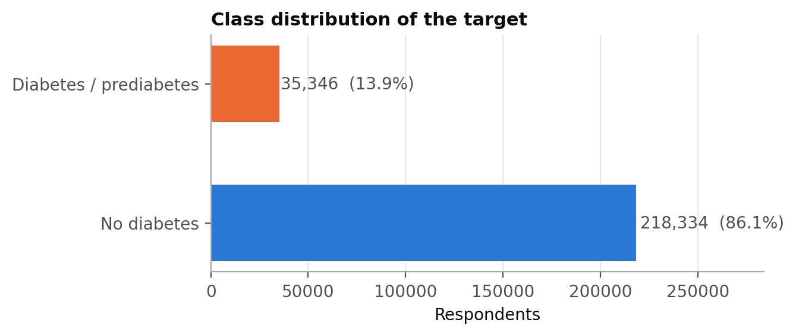

**Fig. 2.** Class-conditional distributions of BMI and self-reported poor-health days.

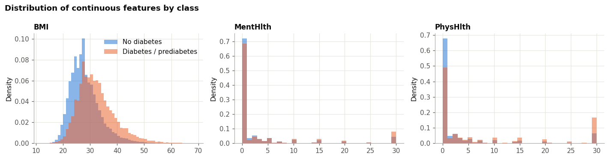

**Fig. 3.** Outcome prevalence across ordinal age, general-health, income, and education categories.

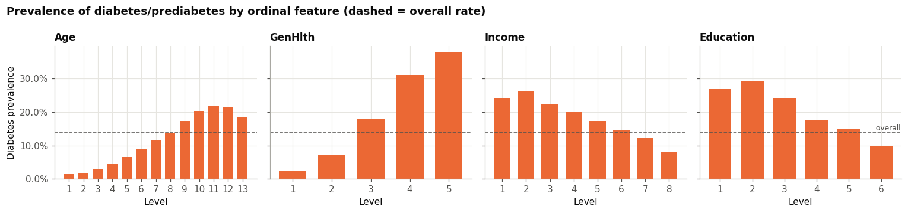

### B. Deduplication and feature construction

There were 24,206 exact duplicate feature rows after ignoring the identifier, approximately 9.5% of the original table. Identical records can occur naturally with coarse survey categories, but copies across training and testing can inflate evaluation. Deduplication before splitting left 229,474 rows and raised positive prevalence to approximately 15.3%, indicating that duplicate profiles were disproportionately negative.

BMI values were clipped to the range 12–60 kg/m² rather than removing respondents with extreme reported values. This bounds implausible values while preserving records and is a pragmatic preprocessing decision, not a clinical correction. Nine row-wise features were then engineered: cardiometabolic load, a lifestyle score, total unhealthy days, World Health Organization BMI categories, an age-by-BMI interaction, a socioeconomic index combining education and income, and binary indicators for care barriers, poor general health, and obesity. The definitions are implemented in the project’s reusable `diabetes_features.py` module. Because the features are deterministic functions of each respondent’s row, their creation does not estimate parameters from held-out records.

**Fig. 4.** Prevalence across cardiometabolic-load values and engineered BMI categories.

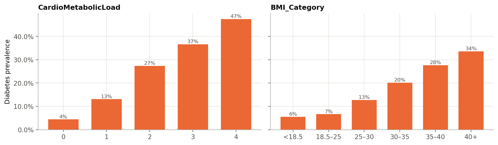

### C. Data partitioning and preprocessing

The deduplicated data were divided into stratified training, validation, and test partitions in a 70:15:15 ratio using random seed 42. The training partition contained 160,631 records; the held-out test partition contained 34,422. The validation partition supported model selection, neural-network early stopping, and operating-threshold selection. All candidate models used the same partitions. The test data were reserved for final comparison and were not used to choose thresholds.

For scikit-learn models, data transformation was encapsulated in a pipeline. Feature engineering was followed by standardisation of continuous and ordinal inputs, while binary indicators passed through without scaling. Placing the transforms inside the pipeline ensures that any data-dependent fitting occurs within each training fold during cross-validation. The neural-network preprocessing followed the same conceptual separation; its input pipeline used TensorFlow’s `tf.data` operations to cache, shuffle training examples, batch them, and prefetch batches.

**Fig. 5.** Correlation between input variables and the binary target. Associations are modest in magnitude, supporting a multivariable approach.

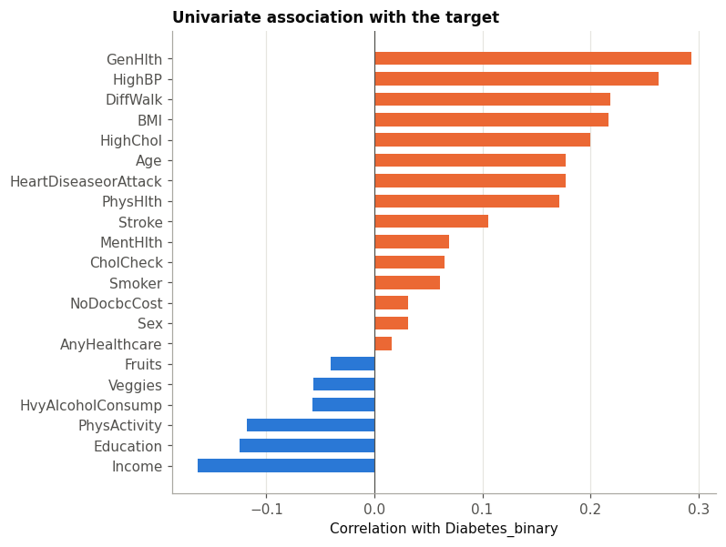

### D. Traditional machine-learning models

Six scikit-learn baselines were examined: a stratified dummy classifier, Gaussian naïve Bayes, logistic regression, a Platt-calibrated linear SVM, random forest, and histogram gradient boosting [20]. A kernel SVM was excluded for computational cost. Class weighting tested imbalance handling but does not guarantee calibrated probabilities.

Feature-ablation and class-weighting experiments compared logistic regression and HGB with raw versus engineered inputs and with versus without balanced weights. `RandomizedSearchCV` [21] tuned logistic regression, random forest, and HGB using three-fold stratified cross-validation on an 80,000-record subsample; winning candidates were refitted on all training data. The search sampled 10, eight, and 20 configurations, respectively. Learning curves assessed whether more examples were likely to improve validation performance.

### E. Neural-network models

Neural networks used TensorFlow and Keras [22]. Experiments included an unweighted 64–32 multilayer perceptron (MLP); its weighted, early-stopped counterpart; a 256–128–64 MLP with batch normalisation [23], dropout [24], and L2 regularisation; a Functional wide-and-deep network; and a seeded search over MLP settings. The wide-and-deep model combines linear and nonlinear paths and learns four-dimensional embeddings for Age, GenHlth, Income, and Education [14].

Training used binary cross-entropy, class weights, early stopping on validation ROC-AUC, and a learning-rate scheduler. The search sampled eight configurations of layer widths and depths, dropout, learning rate, optimiser (Adam [25], RMSprop, or SGD with Nesterov momentum), and batch size. The network with the highest validation ROC-AUC across all 12 neural runs was selected as the best deep model and carried forward to the test set.

### F. Metrics, thresholds, and uncertainty

ROC-AUC compared ranking quality across thresholds. Average precision (reported as PR-AUC) complemented it because the positive class is uncommon [16]. At selected thresholds, performance was summarised using precision, recall (sensitivity), specificity, F1, accuracy, and balanced accuracy. In screening, thresholds reflect the relative costs of missed cases and confirmatory referrals.

Three operating points were considered: the default threshold of 0.5, the validation threshold maximising F1, and a validation threshold targeting at least 80% recall. Each was applied unchanged to test predictions. Test ROC-AUC uncertainty used 1,000 bootstrap resamples; a paired bootstrap compared HGB and the wide-and-deep network on shared resamples. Calibration, confusion matrices, subgroup metrics, and permutation importance complemented these measures.

## IV. Results

### A. Traditional model comparison

The three-fold cross-validation results show that the learned models outperform the dummy baseline, while the leading models remain relatively close. HGB had the highest mean ROC-AUC and average precision among the traditional models. Logistic regression and the calibrated linear SVM achieved similar ROC-AUC, while random forest was slightly lower and Gaussian naïve Bayes was weakest among the substantive models. The linear SVM’s low recall at the reported threshold illustrates why discrimination and classification at a particular threshold should not be treated as interchangeable outcomes.

**TABLE I. Three-fold cross-validation performance of traditional models.**

| Model | ROC-AUC | PR-AUC | Precision | Recall | Balanced accuracy |
|---|---:|---:|---:|---:|---:|
| Histogram gradient boosting | **0.814** | **0.431** | 0.316 | 0.779 | 0.737 |
| Linear SVM (Platt-calibrated) | 0.809 | 0.417 | 0.544 | 0.159 | 0.568 |
| Logistic regression | 0.809 | 0.416 | 0.322 | 0.754 | 0.734 |
| Random forest | 0.805 | 0.416 | 0.386 | 0.569 | 0.703 |
| Gaussian naïve Bayes | 0.780 | 0.369 | 0.336 | 0.621 | 0.700 |
| Stratified dummy | 0.500 | 0.153 | 0.153 | 0.152 | 0.500 |

**Fig. 6.** Cross-validated comparison of traditional models by ROC-AUC and PR-AUC.

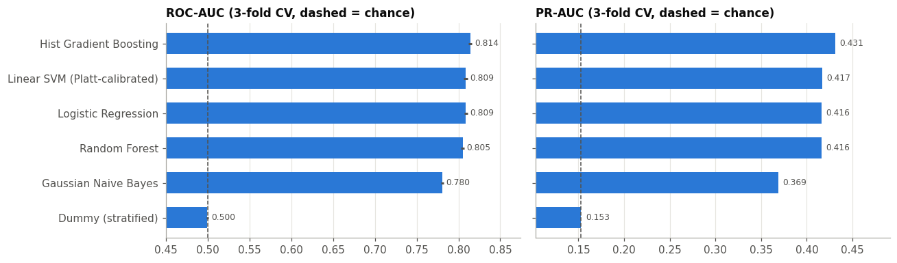

Class weighting altered the observed classification balance much more than it altered ranking. In three-fold cross-validation, weighted logistic regression increased recall at the default threshold from 0.161 to 0.754, while ROC-AUC changed only from 0.809 to 0.809. Weighted HGB increased recall from 0.153 to 0.779 with ROC-AUC moving from 0.814 to 0.814. Precision fell in both cases as more respondents were classified positive. These results show that weighting can change the operating behaviour of a fixed threshold, but that it does not create substantially better rank ordering.

The feature ablation produced a modest improvement for logistic regression: adding engineered features raised ROC-AUC from 0.806 to 0.809 and PR-AUC from 0.404 to 0.416. HGB changed little, from ROC-AUC 0.8140 with raw features to 0.8141 with engineered features. This difference is consistent with the capacity of boosted trees to learn thresholds and interactions from the original variables. Hyperparameter tuning similarly produced little change in validation ROC-AUC for logistic regression and HGB, while improving the random forest from about 0.811 to 0.818. The tuning results favour regularisation rather than maximum complexity: the selected HGB used 15 leaf nodes, a minimum of 234 samples per leaf, and L2 regularisation.

**Fig. 7.** Validation search results for histogram gradient boosting, showing a broad performance plateau across sampled settings.

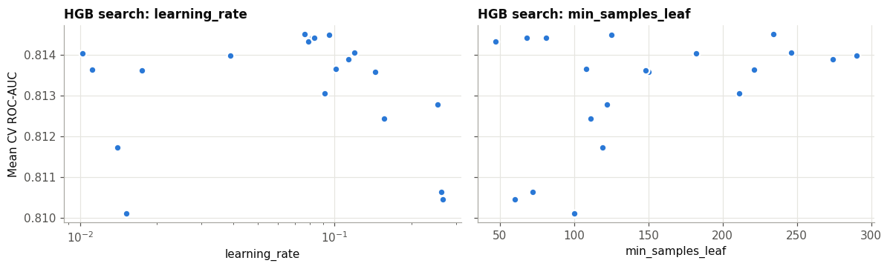

The learning curves provide further context. Logistic regression’s training and validation ROC-AUC converge near 0.809 after roughly 25,000 examples. HGB’s training-validation gap narrows as sample size grows, but its validation score rises only modestly across the largest training subsets. The curves do not show a large late-stage improvement that would suggest more records drawn from the same survey distribution are likely to close the gap between models.

**Fig. 8.** Learning curves for tuned logistic regression and HGB; shaded regions indicate fold variability.

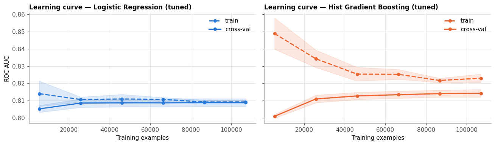

### B. Neural-network experiments

Validation scores for the neural-network experiments fell in a narrow range. DL-2, which added class weights and early stopping to the small MLP, reached a validation ROC-AUC of 0.819 and PR-AUC of 0.443. The deeper regularised MLP and the wide-and-deep network reached validation ROC-AUC around 0.820. The wide-and-deep network (DL-4) had the highest validation scores (ROC-AUC 0.8203, PR-AUC 0.4459) and was selected as the best deep model. The best searched MLP (DL-5.7, 128–64 units, RMSprop) tied on ROC-AUC but had a lower PR-AUC of 0.4438, and the three SGD configurations ranked last in the search. Across all 12 runs, validation ROC-AUC spanned only 0.816–0.820; more parameters or longer training did not yield a consistent advantage.

**TABLE II. Selected neural-network validation results from the experiment log.**

| Experiment | Architecture | Parameters | Validation ROC-AUC | Validation PR-AUC | Best epoch |
|---|---|---:|---:|---:|---:|
| DL-1 | MLP 64–32, unweighted, no early stopping | 4,097 | 0.818 | 0.438 | 12 |
| DL-2 | MLP 64–32, weighted, early stopping | 4,097 | 0.819 | 0.443 | 7 |
| DL-3 | MLP 256–128–64, batch norm, dropout, L2 | 50,497 | 0.820 | 0.445 | 8 |
| DL-4 | Wide-and-deep with ordinal embeddings | 14,800 | **0.820** | **0.446** | 22 |
| DL-5.7 | Searched MLP, 128–64, RMSprop | 12,865 | 0.820 | 0.444 | 14 |

The baseline network showed training-validation divergence consistent with overfitting, whereas early stopping and regularisation constrained training. The wide-and-deep model achieved competitive validation performance with fewer parameters than the widest searched MLP. Its learned embedding for age did not exhibit a simple ordered progression in its low-dimensional projection; this cautions against assuming that embeddings automatically produce clinically interpretable encodings. In aggregate, the neural models matched the discrimination of HGB, but greater depth or architectural complexity brought no meaningful advantage.

**Fig. 9.** Training and validation curves for unweighted and class-weighted baseline MLPs.

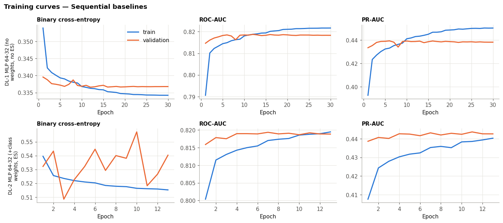

**Fig. 10.** Training curves for the regularised deep MLP and wide-and-deep network.

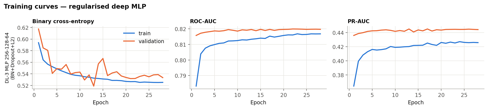

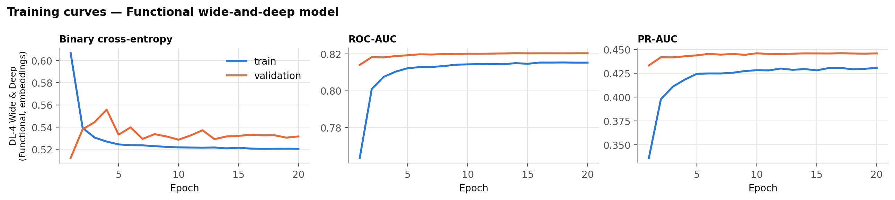

**Fig. 11.** Projection of the learned age embedding for DL-4.

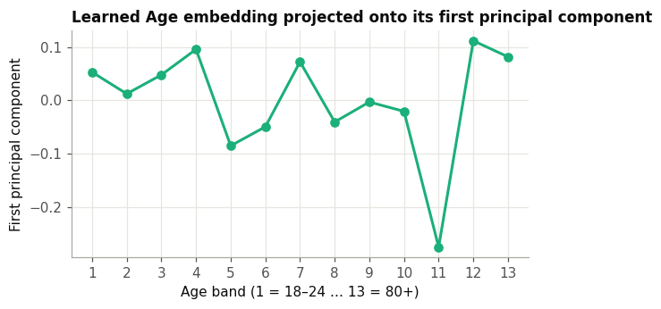

### C. Held-out test performance

The held-out test set contained 34,422 respondents. Tuned HGB achieved ROC-AUC 0.8167 (95% CI 0.8111–0.8225), and the wide-and-deep network (DL-4) achieved 0.8172 (0.8117–0.8231). Tuned logistic regression scored 0.8100 (0.8042–0.8158). Average precision was 0.438 for both HGB and DL-4, and 0.417 for logistic regression. A paired bootstrap on shared resamples estimated the AUC difference between HGB and DL-4 at −0.0005 (95% CI −0.0016 to 0.0005). The traditional and deep-learning approaches were therefore statistically indistinguishable, while both were reliably ahead of logistic regression.

**TABLE III. Held-out test performance (n = 34,422).**

| Model | ROC-AUC (95% CI) | PR-AUC | F1-threshold recall / specificity | Recall-target threshold recall / specificity |
|---|---:|---:|---:|---:|
| Logistic regression (tuned) | 0.810 (0.804–0.816) | 0.417 | 0.653 / 0.788 | 0.799 / 0.675 |
| HGB (tuned) | 0.817 (0.811–0.823) | 0.438 | 0.649 / 0.801 | 0.795 / 0.684 |
| DL-2 MLP | 0.817 (0.812–0.823) | 0.437 | 0.607 / 0.828 | 0.796 / 0.687 |
| DL-4 wide-and-deep | 0.817 (0.812–0.823) | 0.438 | 0.625 / 0.815 | 0.796 / 0.687 |

The validation-selected high-recall operating point produced approximately 80% test recall (0.795–0.799) for all four models, with specificity around 68%. This means that approximately one in three negative respondents would also be referred at that operating point; positive predictive value is correspondingly limited. The F1-selected threshold favoured higher specificity, reducing recall to about 61–65%. Thus the threshold choice changes the number of missed cases and unnecessary referrals more directly than the small observed differences in AUC.

**Fig. 12.** Test ROC and precision-recall curves for logistic regression, HGB, DL-2, and DL-4.

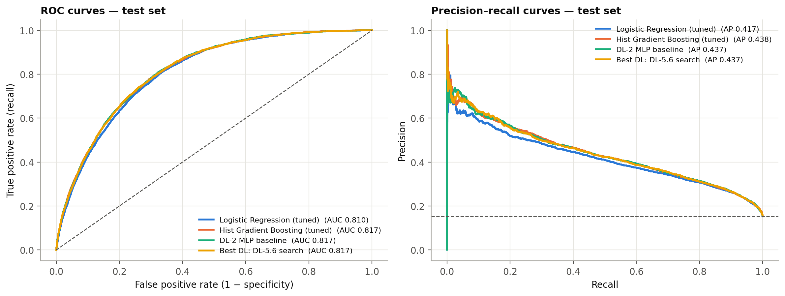

**Fig. 13.** Confusion matrices for HGB and DL-4 at the default and F1-selected thresholds.

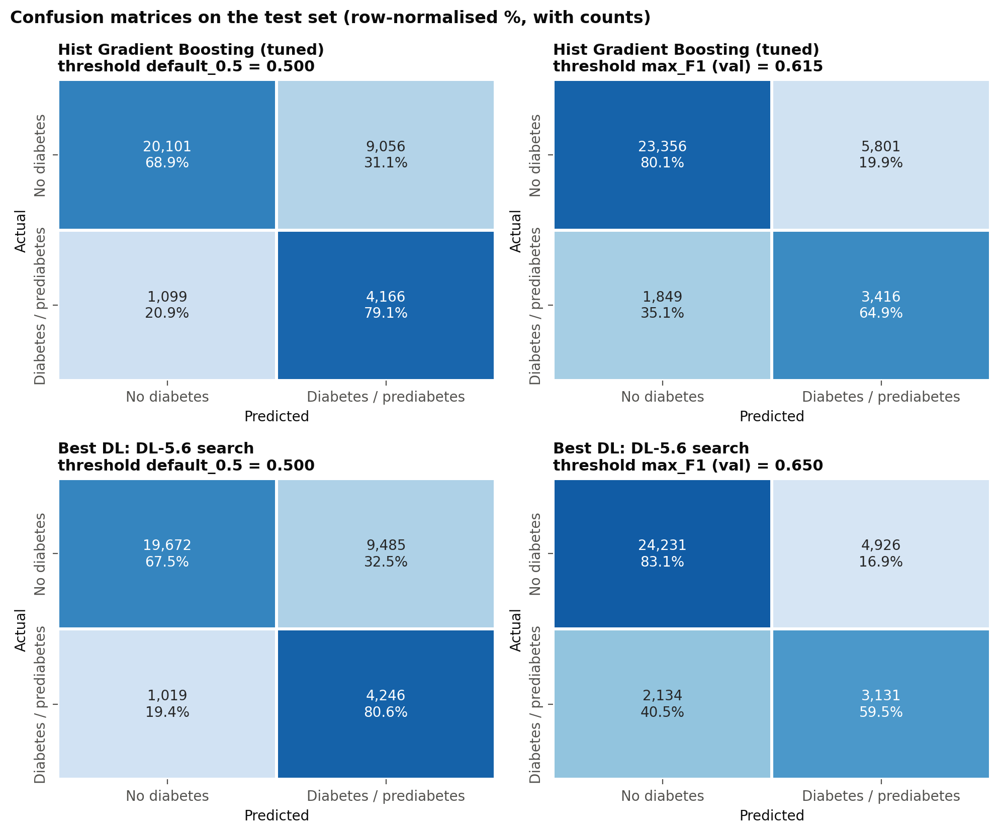

Class-weighted models were not well calibrated as absolute probability estimators. The reliability plots show predicted probabilities tending to exceed observed event frequencies; for example, bins near a predicted probability of 0.6 correspond to observed rates around 0.23. This does not invalidate ROC-AUC as a ranking metric, but it means an uncalibrated model score should not be communicated as an individual’s probability of having diabetes. Any deployment would require calibration using representative, locally collected validation data.

**Fig. 14.** Test-set calibration curves using quantile bins.

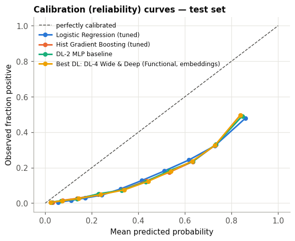

### D. Error and subgroup analysis

The error analysis compared the average characteristics of true positives, false negatives, false positives, and true negatives for DL-4 at its F1-selected threshold (0.628), which produced 3,288 true positives, 1,977 false negatives, 5,385 false positives and 23,772 true negatives. False negatives had lower mean BMI than true positives (28.6 versus 34.2), a lower mean general-health code (2.64 versus 3.69), and lower frequencies of reported hypertension (0.53 versus 0.90) and high cholesterol (0.48 versus 0.78). They also reported difficulty walking less often. In contrast, false positives retained several risk indicators resembling true positives. This pattern suggests that the model is most likely to miss respondents whose questionnaire answers lack the risk profile commonly associated with reported diabetes.

Subgroup analysis reveals considerable variation in recall. For DL-4, recall was 0.234 among respondents aged 18–39, 0.485 for ages 40–54, 0.685 for ages 55–69, and 0.652 for those aged 70 or older. Recall was 0.230 in the BMI-under-25 group and 0.848 in the BMI-35-or-higher group. The youngest group had a within-group ROC-AUC of 0.857, compared with 0.733 among respondents aged 70 or older; high AUC within a group does not guarantee high recall at a fixed threshold, particularly when prevalence is low. Recall differed little by sex, at 0.619 for women and 0.630 for men. It was highest in the lowest income band (0.763), where prevalence was also highest. These descriptive differences should be interpreted in light of group sizes, prevalence, and the threshold used; they are not evidence of causal effects.

**Fig. 15.** Recall, precision, prevalence, and AUC by age, sex, income, and BMI groups. Group rates are descriptive and depend on the selected operating threshold.

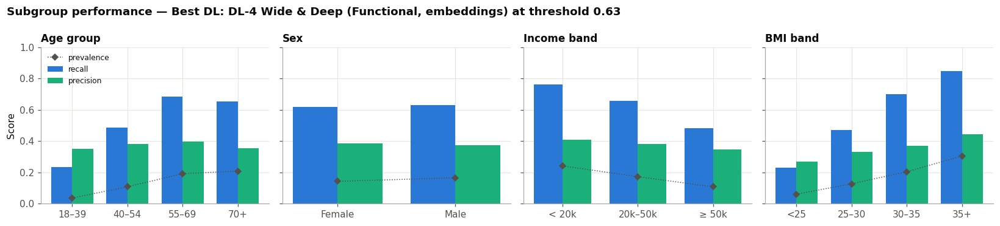

Permutation importance for tuned HGB ranked general health highest, followed by BMI and age. The corresponding mean ROC-AUC decreases were 0.048, 0.039, and 0.037. High blood pressure and high cholesterol followed at approximately 0.015 and 0.013. Smaller permutation effects for lifestyle measures do not imply that those behaviours are unimportant to health; they mean that, in this fitted model and dataset, shuffling those columns reduced discrimination less after the other correlated features were available.

**Fig. 16.** Permutation importance for tuned HGB, measured as mean validation ROC-AUC decrease over five repeats.

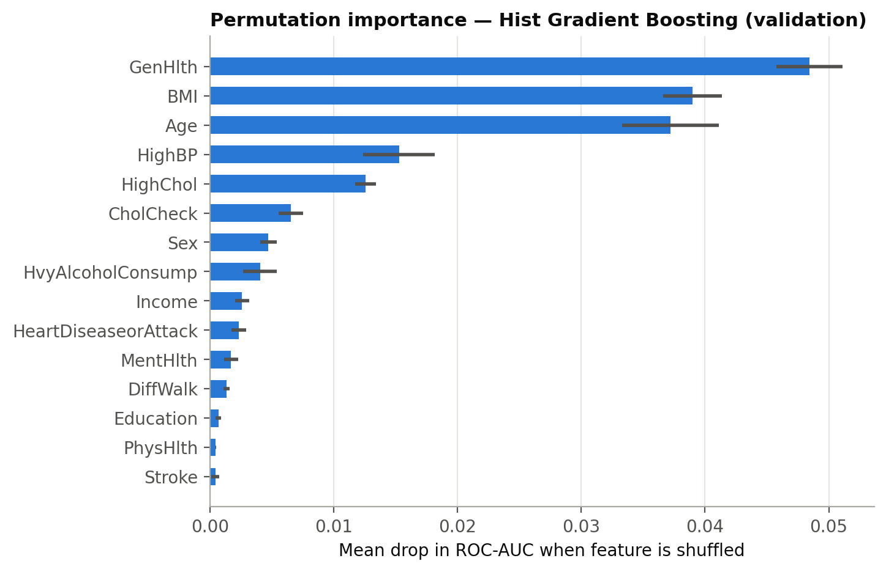

## V. Discussion

### A. Model family and practical value

Deep learning offered no advantage over traditional machine learning on this dataset. HGB and the selected neural network have nearly identical held-out ROC-AUC and overlapping bootstrap intervals. The paired comparison between HGB and DL-4 is also consistent with no detectable difference. This result aligns with the broader evidence that tree ensembles remain strong competitors on structured tabular data [12], [13]. On this task, model sophistication did not translate into a clear performance improvement.

Practical considerations favour a simple, reproducible baseline. HGB handles nonlinear splits without neural-network training schedules, while logistic regression offers a direct linear reference with only a small AUC reduction. Selection should also consider calibration, threshold behaviour, computation, and clinical review. The AUC results provide no empirical reason to prefer a more complex network solely for discrimination.

### B. The information ceiling

The results suggest that the ceiling is associated with the available survey information. Multiple model families converge near ROC-AUC 0.81–0.82; HGB learning curves plateau, and neural-network configurations vary little despite substantial differences in parameter count and regularisation. These observations point to limited signal in the available predictors rather than a modelling shortfall, although they do not prove an irreducible statistical limit. Some headroom could remain in better labels, richer measurements, different sampling, or models not included in this comparison.

The false-negative profiles make the limitation concrete. A respondent who reports diabetes but has normal-range BMI, no known hypertension, and good self-rated health resembles many negative respondents in the available feature space. Questionnaire variables cannot reliably recover biochemical evidence that was never measured. The role of general health also requires caution: it can reflect consequences of existing disease rather than an antecedent cause. As a result, this model is more accurately described as identifying patterns associated with reported disease status than predicting future disease onset.

### C. Thresholds, class weighting, and calibration

Class weighting had little effect on AUC but greatly changed recall and precision at the default threshold. Reweighting changes the objective and can shift scores without improving rank ordering. A validation threshold is therefore a policy choice: lowering it can catch more positives but increases referrals, while raising it reduces referrals at the cost of missed cases. The appropriate point depends on costs, resources, and the clinical pathway.

The rule targeting 80% recall achieved 79.5–79.9% on the test set; a finite validation sample cannot guarantee this rate in future data. At approximately 68% specificity, many non-cases would be referred. Such a trade-off requires accessible confirmatory testing. Class-weighted probabilities also exceeded observed frequencies in the calibration plot. AUC and thresholds can be assessed despite this, but individual risk communication requires calibration and independent validation [18].

### D. Subgroup performance and equity

The subgroup results show that a single threshold does not yield uniform sensitivity. Recall is lower in younger respondents and people with BMI below 25 than in older and heavier groups. Prevalence, reported risk patterns, and label limitations may contribute, but these descriptive results do not identify a cause. Low recall among groups with fewer conventional risk indicators remains a safety concern that aggregate ROC-AUC can obscure.

Performance should therefore be assessed at the intended operating point and within clinically relevant subgroups. Any proposal to use group-specific thresholds would require clinical and ethical review, sufficient local validation data, and an explicit justification; it should not be adopted from these exploratory U.S. results alone. Monitoring should include false-negative rates, calibration, referral volume, and access to follow-up testing. The high importance of self-rated health also warrants careful communication, since the model may partly encode symptoms and functional limitations that result from disease.

### E. Limitations and external validity

Several limitations constrain interpretation. The cross-sectional data and self-reported target cannot establish prediction of disease onset. The positive label combines prediabetes and diabetes, while undiagnosed cases may be labelled negative, distorting both ranking and error analysis. BRFSS represents U.S. adults in 2015 and does not establish transportability to African populations or other settings. Demographics, diet, access, and BMI-associated risk may alter prevalence and predictor relationships. Evidence suggests ethnicity-specific BMI thresholds for diabetes-related risk [26], supporting local validation rather than importing U.S. cutoffs.

Exact duplicates are plausible in coarse survey data; removing them prevents one form of overlap but changes sample composition and prevalence. Results apply to this deduplicated cohort. Neural-network training is also not bit-for-bit reproducible across hardware and library versions: the top deep configurations differed by less than 0.001 in validation ROC-AUC, so their ranking can change between runs even though the overall conclusion does not.

No prospective impact study was conducted, so the analysis does not quantify health outcomes, acceptability, cost-effectiveness, or net clinical benefit. High recall is not inherently beneficial if flagged respondents cannot obtain confirmatory testing. Future work should collect local data, validate across time and place, assess thresholds and calibration, and review subgroup safety and the referral pathway with clinicians.

## VI. Conclusion

This study compared traditional machine-learning algorithms and deep neural networks for identifying BRFSS respondents reporting prediabetes or diabetes from self-reported health indicators. After removing duplicate records and using shared stratified splits, tuned HGB and the best neural network, a Functional wide-and-deep model, both achieved a test ROC-AUC of 0.817. A paired bootstrap found no meaningful difference between them (ΔAUC −0.0005, 95% CI −0.0016 to 0.0005), so the neural approach offered no performance advantage, and gradient boosting reached it with less tuning and computation.

The practical lesson is that operating threshold, calibration, data quality, and subgroup performance deserve at least as much attention as model choice. A threshold chosen to target high recall detected around four-fifths of positive test respondents, but at the cost of modest specificity and many additional referrals. The model’s scores should not be presented as calibrated individual risk, and its lower recall among younger and leaner respondents needs particular scrutiny.

Questionnaire-based methods may help prioritise confirmatory screening, but the current evidence supports only an exploratory classifier on a historical U.S. survey. It does not support diagnosis or unvalidated use in Africa. The next steps are to recalibrate on representative local data, assess subgroup errors and referral capacity, and validate clinical utility prospectively. A questionnaire can help decide who should be offered a test; it cannot replace the test itself.

## References

[1] International Diabetes Federation, *IDF Diabetes Atlas*, 10th ed. Brussels, Belgium: IDF, 2021.

[2] J. C. N. Mbanya, A. A. Motala, E. Sobngwi, F. K. Assah, and S. T. Enoru, “Diabetes in sub-Saharan Africa,” *The Lancet*, vol. 375, no. 9733, pp. 2254–2266, 2010.

[3] Centers for Disease Control and Prevention, “CDC Diabetes Health Indicators,” UCI Machine Learning Repository, 2023. [Online]. Available: https://doi.org/10.24432/C53919

[4] J. Lindström and J. Tuomilehto, “The diabetes risk score: A practical tool to predict type 2 diabetes risk,” *Diabetes Care*, vol. 26, no. 3, pp. 725–731, 2003.

[5] H. Bang *et al*., “Development and validation of a patient self-assessment score for diabetes risk,” *Annals of Internal Medicine*, vol. 151, no. 11, pp. 775–783, 2009.

[6] J. W. Smith, J. E. Everhart, W. C. Dickson, W. C. Knowler, and R. S. Johannes, “Using the ADAP learning algorithm to forecast the onset of diabetes mellitus,” in *Proc. Annu. Symp. Computer Applications in Medical Care*, 1988, pp. 261–265.

[7] A. Dinh, S. Miertschin, A. Young, and S. D. Mohanty, “A data-driven approach to predicting diabetes and cardiovascular disease with machine learning,” *BMC Medical Informatics and Decision Making*, vol. 19, art. 211, 2019.

[8] Q. Zou, K. Qu, Y. Luo, D. Yin, Y. Ju, and H. Tang, “Predicting diabetes mellitus with machine learning techniques,” *Frontiers in Genetics*, vol. 9, art. 515, 2018.

[9] Z. Xie, O. Nikolayeva, J. Luo, and D. Li, “Building risk prediction models for type 2 diabetes using machine learning techniques,” *Preventing Chronic Disease*, vol. 16, art. 190109, 2019.

[10] T. Chen and C. Guestrin, “XGBoost: A scalable tree boosting system,” in *Proc. 22nd ACM SIGKDD Int. Conf. Knowledge Discovery and Data Mining*, 2016, pp. 785–794.

[11] G. Ke *et al*., “LightGBM: A highly efficient gradient boosting decision tree,” in *Advances in Neural Information Processing Systems 30*, 2017, pp. 3146–3154.

[12] R. Shwartz-Ziv and A. Armon, “Tabular data: Deep learning is not all you need,” *Information Fusion*, vol. 81, pp. 84–90, 2022.

[13] L. Grinsztajn, E. Oyallon, and G. Varoquaux, “Why do tree-based models still outperform deep learning on typical tabular data?” in *Advances in Neural Information Processing Systems 35 (Datasets and Benchmarks Track)*, 2022.

[14] H.-T. Cheng *et al*., “Wide & deep learning for recommender systems,” in *Proc. 1st Workshop on Deep Learning for Recommender Systems*, 2016, pp. 7–10.

[15] H. He and E. A. Garcia, “Learning from imbalanced data,” *IEEE Transactions on Knowledge and Data Engineering*, vol. 21, no. 9, pp. 1263–1284, 2009.

[16] T. Saito and M. Rehmsmeier, “The precision-recall plot is more informative than the ROC plot when evaluating binary classifiers on imbalanced datasets,” *PLoS ONE*, vol. 10, no. 3, e0118432, 2015.

[17] S. Kaufman, S. Rosset, C. Perlich, and O. Stitelman, “Leakage in data mining: Formulation, detection, and avoidance,” *ACM Transactions on Knowledge Discovery from Data*, vol. 6, no. 4, pp. 1–21, 2012.

[18] A. Niculescu-Mizil and R. Caruana, “Predicting good probabilities with supervised learning,” in *Proc. 22nd Int. Conf. Machine Learning*, 2005, pp. 625–632.

[19] Z. Obermeyer, B. Powers, C. Vogeli, and S. Mullainathan, “Dissecting racial bias in an algorithm used to manage the health of populations,” *Science*, vol. 366, no. 6464, pp. 447–453, 2019.

[20] F. Pedregosa *et al*., “Scikit-learn: Machine learning in Python,” *Journal of Machine Learning Research*, vol. 12, pp. 2825–2830, 2011.

[21] J. Bergstra and Y. Bengio, “Random search for hyper-parameter optimization,” *Journal of Machine Learning Research*, vol. 13, pp. 281–305, 2012.

[22] M. Abadi *et al*., “TensorFlow: A system for large-scale machine learning,” in *Proc. 12th USENIX Symp. Operating Systems Design and Implementation*, 2016, pp. 265–283.

[23] S. Ioffe and C. Szegedy, “Batch normalization: Accelerating deep network training by reducing internal covariate shift,” in *Proc. 32nd Int. Conf. Machine Learning*, 2015, pp. 448–456.

[24] N. Srivastava, G. Hinton, A. Krizhevsky, I. Sutskever, and R. Salakhutdinov, “Dropout: A simple way to prevent neural networks from overfitting,” *Journal of Machine Learning Research*, vol. 15, pp. 1929–1958, 2014.

[25] D. P. Kingma and J. Ba, “Adam: A method for stochastic optimization,” in *Proc. 3rd Int. Conf. Learning Representations*, 2015.

[26] R. Caleyachetty *et al*., “Ethnicity-specific BMI cutoffs for obesity based on type 2 diabetes risk in England: A population-based cohort study,” *The Lancet Diabetes & Endocrinology*, vol. 9, no. 7, pp. 419–426, 2021.
